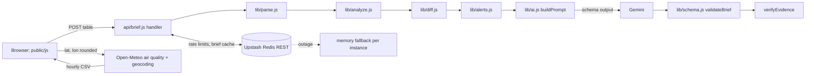

# Civic Air Brief

Turn a messy air quality table, or the air where you are, into a brief that 8 kinds of people can act on: a ward officer, a housing society, a school, a health officer or PHC doctor, traffic police, a construction or industry site manager, a parent, or a delivery rider or other outdoor worker. Every number in the brief links back to the rows it came from. Gemini writes the words; code computes every number.

## Access for evaluators

- Live app: see the deployed link on the submission
- Access code: `airbrief2026` (type it in the Access code field)
- Select **Try the sample table**, then **Write the brief**. Write a second brief to see **Since your last brief**.
- Or select **Use my location** (or search a city) for the last 24 hours of modelled air where you are.

## Requirement map

| # | Requirement | Feature | Code | Test |
| --- | --- | --- | --- | --- |
| 1 | Interpret messy tables | delimiter, header, unit and date detection; 7 kinds of bad data flagged with row numbers | `lib/parse.js` `parseTable`, `parseRow` | `clause 1: a messy pasted table is interpreted` |
| 2 | Trends and hotspots | per-site averages, CPCB bands, x-limit ratios, trends, hotspot ranking | `lib/analyze.js` `analyze` | `clause 2: trends and hotspots come from computed facts` |
| 3 | Prioritised actions per role | 8 role profiles, each with what that role can and cannot do; alert next steps per role | `lib/ai.js` `buildPrompt`, `lib/alerts.js` `NEXT_STEPS` | `clause 3: actions are prioritised for the asking role` |
| 4 | Traceable findings, gaps flagged | fact ids with source rows; citations verified; Uncertain tag | `lib/ai.js` `verifyEvidence` | `clause 4: every finding is traceable and gaps are flagged` |
| 5 | Compare with the previous brief | snapshot diff, new and resolved hotspots, worsened alerts | `lib/diff.js` `compareSnapshots` | `clause 5: each brief is compared with the previous one` |
| 6 | Note and advisories in languages and reading levels | internal note; advisories in up to 4 of 11 languages incl. outdoor workers | `lib/ai.js` `RESPONSE_SCHEMA`, `lib/schema.js` `validateBrief` | `clause 6: note and advisories in the requested languages` |
| 7 | Proactive help without being asked | alerts computed before the AI runs and shown first | `lib/alerts.js` `deriveAlerts` | `test/alerts.test.js` |
| 8 | Data for people without a table | Use my location: Open-Meteo CAMS hourly air into the same pipeline, city search fallback | `public/lib/geo.js` `toTable`, `searchCity` | `test/geo.test.js` (real captured response, fake fetch) |
| 9 | Safe going-out plan for children and older adults | inhaled dose, band, best 2-hour window today | `public/lib/exposure.js` `inhaledDose`, `bestWindow` | `test/exposure.test.js` |
| 10 | Ask for trees or a green buffer | cited letter to the ward office in the same Gemini call | `RESPONSE_SCHEMA.greenRequest`, `cleanGreen` | `greenRequest letter is kept when complete and dropped` |
| 11 | Interface in more than one language | English and Hindi from one dictionary, `html lang` follows | `public/js/i18n.js` | `test/i18n.test.js` |

## Architecture



Request lifecycle: `validateRequest` (size, whitelists) then `checkAccess` (constant time) then the per-IP and global limits in the store, then `prepareBrief` (parse, analyse, diff, alerts, prompt), then the cache by `cacheKey` (sha256 of prompt version, model and prompt), then `callGemini` with retry, then `validateBrief` and `verifyEvidence`. A complete brief is cached for 30 minutes; a partial one never is.

Shared-store path: every instance reads and writes rate limits and cached briefs in Upstash over HTTPS with a 400 ms timeout. If the store fails, the request still completes on a bounded per-instance memory store (5,000 keys). Tests prove 2 handler instances sharing 1 store serve the second call from cache.

## GenAI: where it runs

| Output | Where |
| --- | --- |
| Summary, trends, hotspots, prioritised actions, data caveats, change narrative, internal note | `lib/ai.js` `RESPONSE_SCHEMA`, one call |
| Advisories per language and reading level, with children, older adults, sensitive groups and outdoor workers | same call, `advisories` |
| Tree or green-buffer letter, with fact ids | same call, `greenRequest` |

Hallucination guard: the model sees only facts computed in code (at most 120 facts, 24 KB). Every claim must cite fact ids; unknown ids are removed and uncited claims are tagged Uncertain. Numbers in free text that are not in the facts are listed back to the user.

## Efficiency (measured with `node scripts/bench.js`, Node 24.15.0, median of 20 runs, this app's code only)

| Input | Pipeline | Prompt | Facts sent | Facts left out |
| --- | --- | --- | --- | --- |
| Sample, 21 rows | 2.2 ms | 6,965 bytes | 35 | 0 |
| 5,000 rows built from the sample | 129.5 ms | 18,441 bytes | 120 | 157 |

| Handler path (memory store, Gemini replaced by a fixed stub) | Time | Response |
| --- | --- | --- |
| First call | 6.32 ms | 16,391 bytes |
| Identical call, served from cache | 1.09 ms | `cached: true` |

Live numbers (Gemini latency, cache hit across instances): run `BRIEF_ACCESS_CODE=... node scripts/bench-live.js https://<deployment>`. NOT MEASURED in this README yet.

## Security

| Control | Where |
| --- | --- |
| Gemini key server side only | `lib/config.js`, `lib/ai.js` |
| Access code in constant time, 10 wrong codes per 10 minutes per IP | `lib/validate.js` `checkAccess`, `api/brief.js` |
| Per-IP and global hourly limits, shared across instances | `api/brief.js`, `lib/store.js` |
| Input whitelists, 300 KB table, 5,000 rows, site names cut to 200 characters | `lib/validate.js`, `lib/parse.js` |
| CSP (connect-src: self and the 2 Open-Meteo hosts only), HSTS, COOP, CORP, nosniff, frame deny | `vercel.json` |
| UI renders data as text only, never as HTML | `public/js/dom.js` `el` |
| Location rounded to about 1 km, sent only to Open-Meteo, never stored or sent to our server | `public/lib/geo.js` `airQualityUrl` |
| Logs hold outcomes and timings, never table contents | `api/brief.js` `log` |

## Configuration

| Variable | Required | Default | Notes |
| --- | --- | --- | --- |
| `GEMINI_API_KEY` | yes | none | server side only |
| `GEMINI_MODEL` | no | `gemini-3.5-flash` | falls back to `gemini-flash-latest` on 404, 429, 5xx |
| `ACCESS_CODE` | no | empty (open) | evaluator code |
| `MAX_BRIEFS_PER_HOUR` | no | 60 | clamped to 1 to 10,000 |
| `UPSTASH_REDIS_REST_URL` / `UPSTASH_REDIS_REST_TOKEN` | no | memory | `KV_REST_API_URL` / `KV_REST_API_TOKEN` also work; https only |

Every variable is read once in `lib/config.js` `loadConfig` and covered by `test/config.test.js`.

## Accessibility (WCAG 2.2 AA)

Contrast, computed by `node scripts/contrast.js` from `public/styles.css`: 24 pairs, 0 failed.

| Pair | Light | Dark | Needs |
| --- | --- | --- | --- |
| Body text | 19.80:1 | 16.12:1 | 4.5:1 |
| Secondary text | 8.24:1 | 9.47:1 | 4.5:1 |
| Links, fact chips | 9.09:1 | 8.28:1 | 4.5:1 |
| Primary button label | 9.09:1 | 8.32:1 | 4.5:1 |
| Severe label | 8.14:1 | 8.56:1 | 4.5:1 |
| Uncertain label | 6.46:1 | 8.72:1 | 4.5:1 |
| Advisory card text | 14.79:1 | 14.79:1 | 4.5:1 |
| Field and button borders | 4.98:1 | 5.88:1 | 3:1 |
| Focus ring | 9.09:1 | 8.28:1 | 3:1 |

Keyboard: Tab through every control; skip link first; advisory tabs use ArrowLeft, ArrowRight, Home, End; focus moves to the summary when a brief arrives; the ? button opens the reading guide. Text size A, A+, A++ (100, 118, 135 percent). Advisories set `lang` and `dir` per language (Urdu right to left). Motion is transform only and switched off under `prefers-reduced-motion`. axe run: NOT RUN.

## Testing

`npm test`: 142 tests, 0 failures, exit 0. `npm run coverage`: 98.18% lines, 91.96% branches, 96.73% functions. `npm run lint`: exit 0, longest function 36 lines (limit 40). No test touches the network; the Open-Meteo tests use a real captured response with a fake fetch.

## Run locally

```bash
GEMINI_API_KEY=your_key ACCESS_CODE=airbrief2026 node dev-server.js
npm test
```

Zero runtime dependencies. Node 22 or newer.

## Limits

- Standards are India NAAQS and CPCB bands; trends need at least 3 dated readings per site and pollutant.
- Location data is modelled (CAMS via Open-Meteo), not a station reading.
- The going-out numbers are indicative, not medical advice.
- History stays in this browser only. Interface languages today: English and Hindi (AI translated); Marathi, Tamil and Bengali are next.
